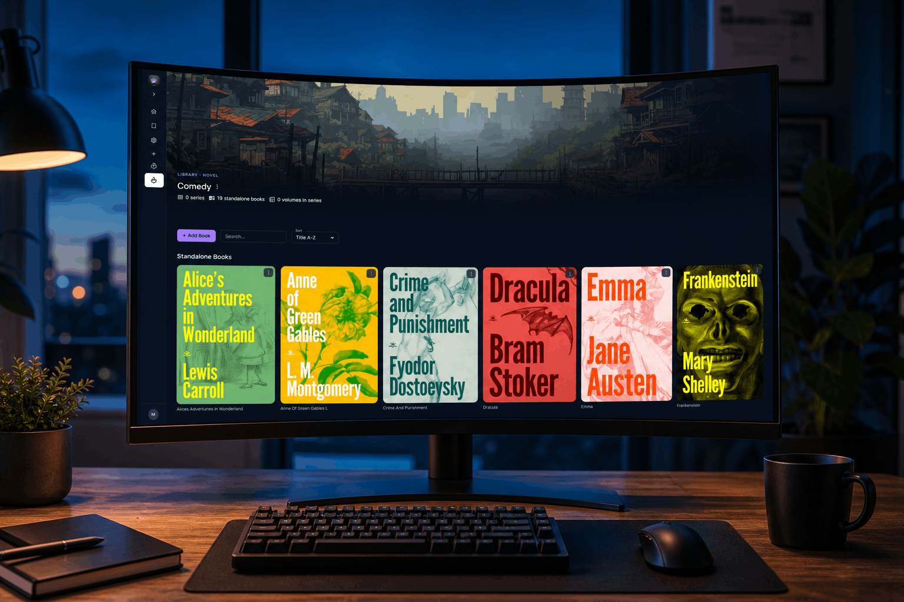
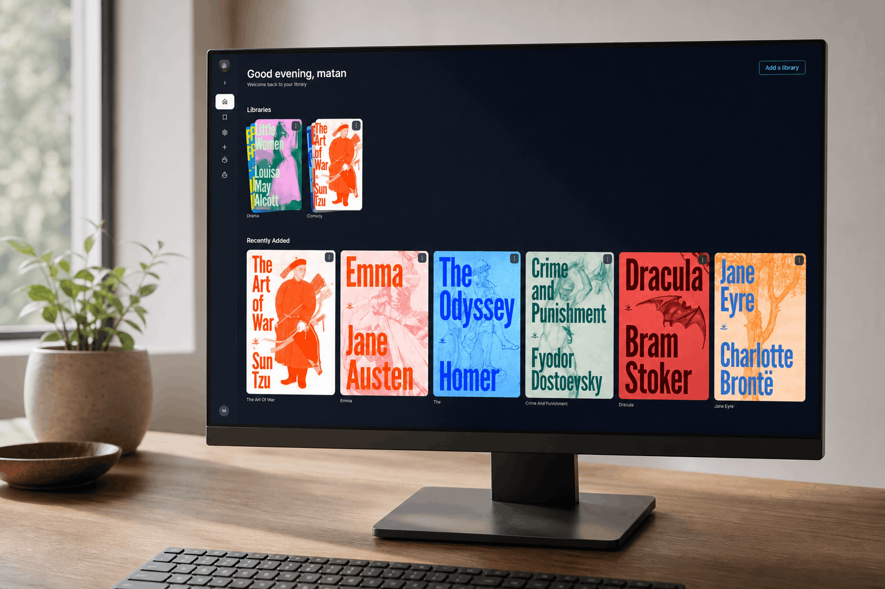
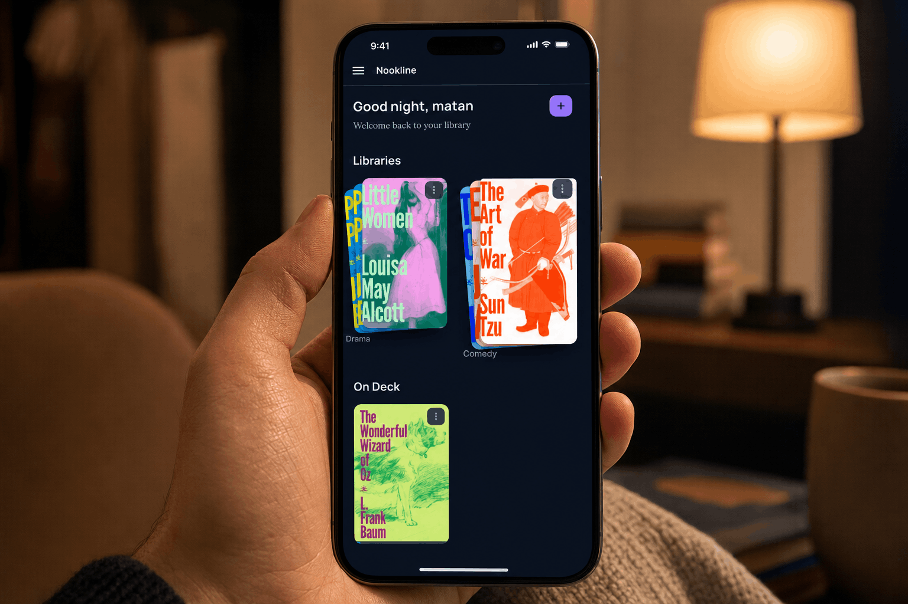
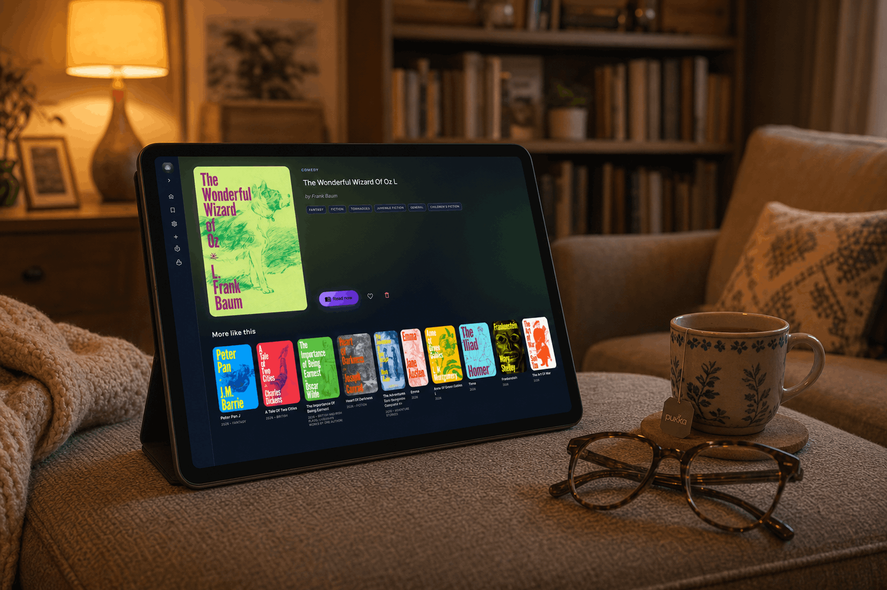
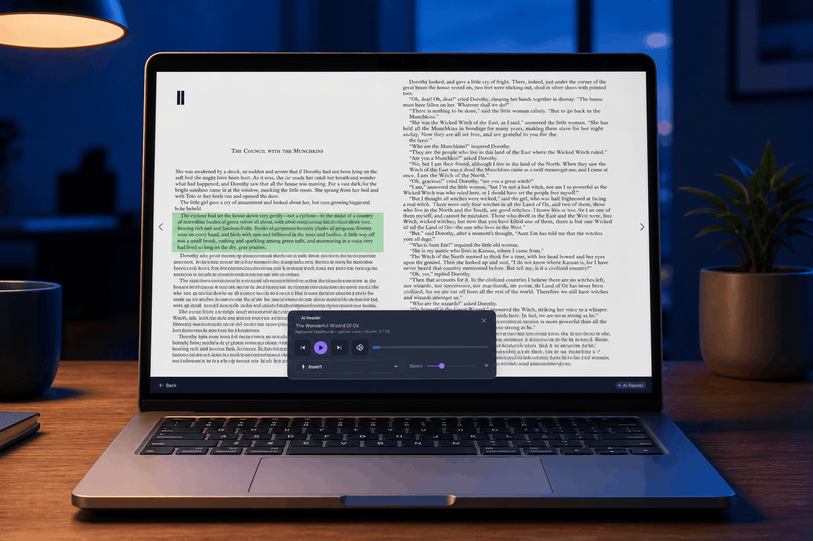
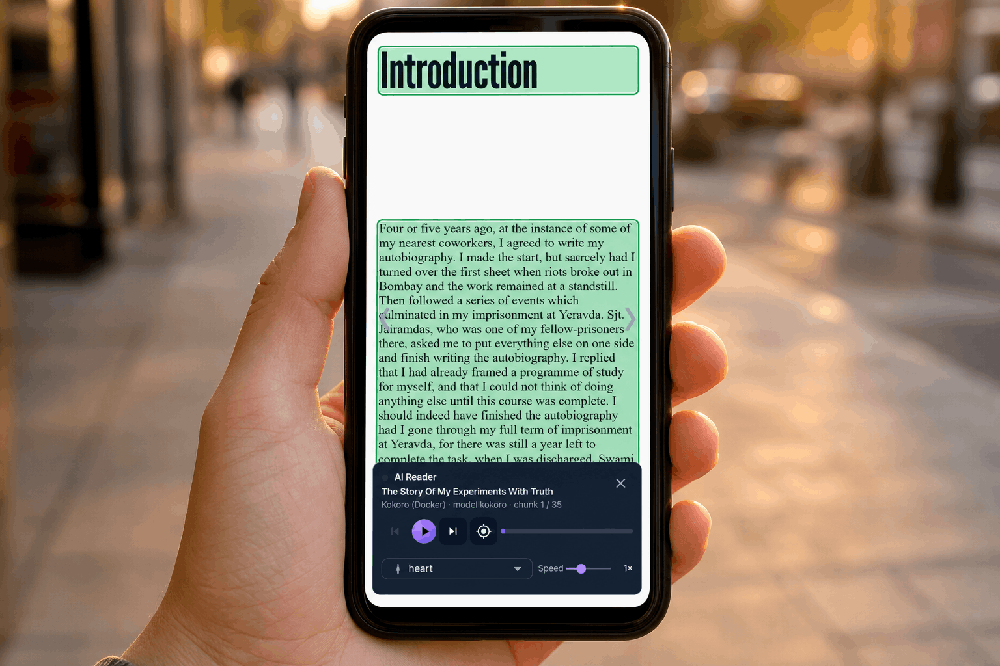
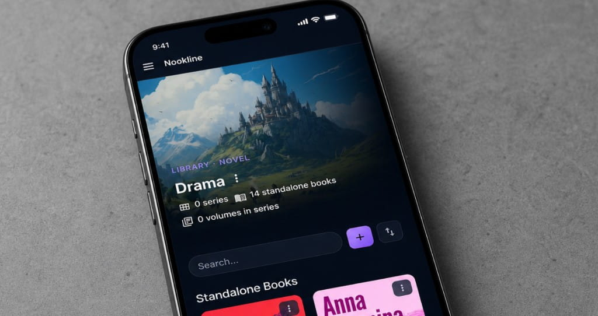
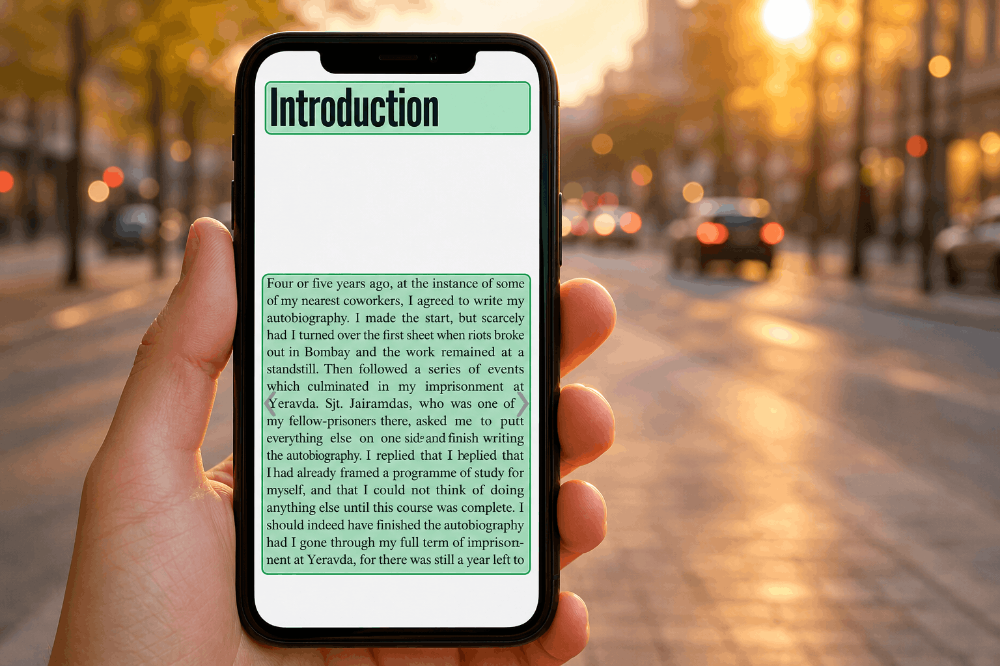

# Nookline

Organize your books, read them in your browser, and turn pages with optional read-aloud. **Run everything on your own machine with Docker.**

---



<table>
<tbody>
<tr valign="top">
<td width="50%"></td>
<td width="50%"></td>
</tr>
<tr valign="top">
<td width="50%"></td>
<td width="50%"></td>
</tr>
<tr valign="top">
<td width="50%"></td>
<td width="50%"></td>
</tr>
<tr valign="top">
<td width="50%"></td>
<td width="50%"></td>
</tr>
</tbody>
</table>

---

## Prerequisites

- [Docker](https://docs.docker.com/get-docker/) and Docker Compose v2
- Optional `.env` (copy from `.env.example` for ports, `TTS_URL`, etc.

---

## Quick start

Best if you already run TTS elsewhere or you only care about reading without **AI reader / Kokoro**:

1. Optionally point **`TTS_URL`** at another TTS host (CPU Kokoro, OpenAI-compatible server, etc.). If you skip this and omit the Kokoro service, voice features may error until `TTS_URL` is reachable.

2. Start only app services (default profile — **does not start** Kokoro):

   ```bash
   mkdir -p books
   docker compose up -d --build
   ```

   - Frontend: **http://localhost:${FRONTEND_PORT:-3009}**
   - API health: **http://localhost:${BACKEND_PORT:-4005}/api/health**

3. Uploaded files and SQLite live in the **`books`** bind mount (`BOOKS_BIND`) and **`nookline-data`** Docker volume respectively.

---

## With Kokoro (GPU, bundled profile)

Uses the optional **`kokoro`** Compose profile (`ghcr.io/remsky/kokoro-fastapi-gpu`). Requires **NVIDIA Container Toolkit** and a suitable GPU.

```bash
docker compose --profile kokoro up -d --build
```

`TTS_URL` in `.env` defaults to `http://kokoro-nookline:8880`, which resolves when the Kokoro container is running on profile `kokoro`.

Kokoro is also exposed on the host at **http://localhost:8882 → 8880** (see `docker-compose.yml`).

---

## Environment summary

| Variable                                | Purpose                                              |
| --------------------------------------- | ---------------------------------------------------- |
| **`JWT_SECRET`**                        | Optional in Docker — signs session tokens; if unset, generated on first start and stored on the data volume (`/data/.jwt_secret`) |
| **`BOOKS_BIND`**                        | Host folder mounted at `/books` in the backend       |
| **`BACKEND_PORT`**, **`FRONTEND_PORT`** | Published HTTP ports                                 |
| **`TTS_URL`**                           | Base URL for OpenAI-compatible TTS used by AI reader flows (Compose defaults to bundled Kokoro) |

## Development (without Compose)

See `frontend/` and `backend/` package scripts (`npm`, `bun`). Use a `.env` in each folder as documented in your local setup — **do not commit real secrets.**

Project Name: Nookline

Repo: https://github.com/matan-chan/nookline
Description:
I used to read with Natural Reader. The free voices sounded robotic, but the bigger problem for me was what it read: it kept speaking the episode/chapter title at the top of the page and the page number over and over. That pulled me out of the story every few seconds.
I wanted something I could self-host, with voices that actually sound good, and read-aloud that sticks to the book text (not headers and page chrome). I also wanted a library UI that feels calm and modern, not like admin software from 2010.
So I built Nookline.
It is not trying to be Kavita, Calibre-Web, or Audiobookshelf. Those are great at library management (and audiobooks). Nookline is reader-first: a minimal UI for browsing your books, reading EPUB/PDF in the browser, and optional AI read-aloud that plugs into any OpenAI-compatible TTS you already run (local Kokoro on GPU works great for realtime reading and nice voices). Swap engines in Settings without rebuilding the app.
Everything runs on your machine with Docker. No cloud account with me.
Features:
EPUB and PDF upload, libraries, series, and search
In-browser reader with bookmarks and highlights (right-click to save)
AI reader reads the current chapter/page in chunks, remembers position per book, prefetches the next chunk while one plays
TTS flexibility: bundled Kokoro GPU profile in Compose, or point TTS_URL at any OpenAI-compatible endpoint
Open Library metadata lookup when you add books (cover, author, etc. when it matches)
Multi-user: each user gets their own libraries; first signup is admin
Customization: site name, favicon, library banners, light/dark themes
Folder sync: drop files in your books bind mount and refetch the library
Optional PDF header/footer stripping for TTS so repeating page numbers do not get spoken

Deployment:
It can be installed via Docker using a container hosted on GHCR, or built and installed from source using instructions in the README.

AI Involvement:
I’m a professional software developer. This project was not “vibe coded” end-to-end.
Development (how the app was built):
Cursor was used as coding assistant for scaffolding, refactors, tests, and some frontend/backend implementation.
I designed the architecture, reviewed all merged code, and ran the app locally before shipping. I treat AI output like a junior contributor: useful drafts, not auto-merge.
