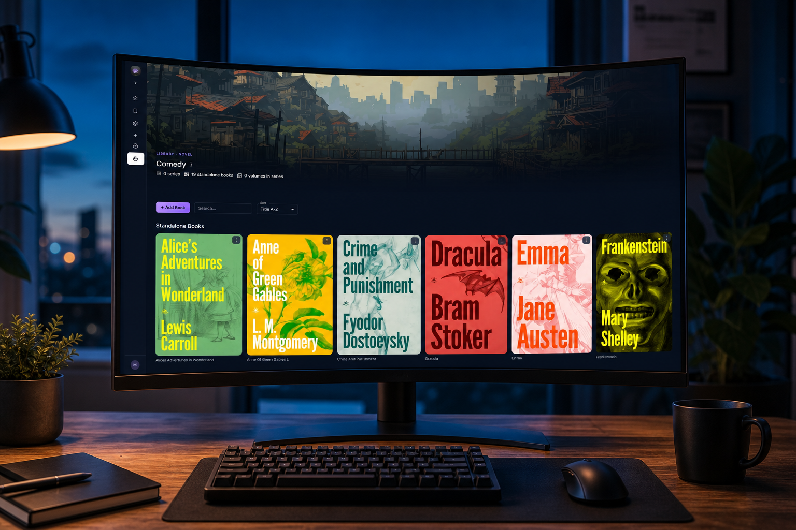
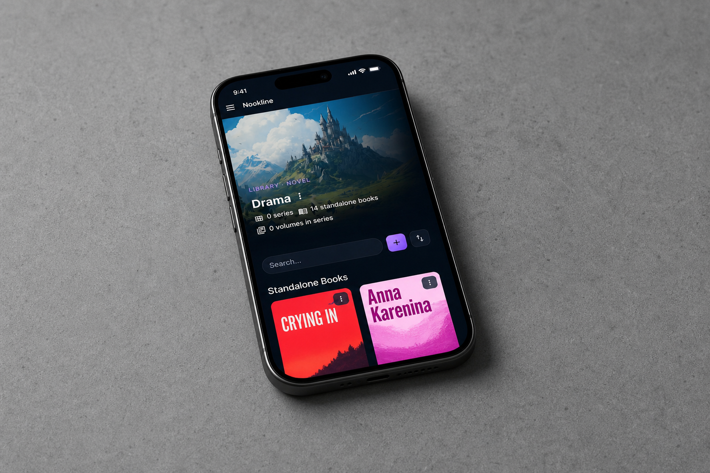

# Nookline

Organize your books, read them in your browser, and turn pages with optional read-aloud. **Run everything on your own machine with Docker.**

---



<table>
<tbody>
<tr valign="top">
<td width="50%"></td>
<td width="50%"></td>
</tr>
<tr valign="top">
<td width="50%"></td>
<td width="50%"></td>
</tr>
<tr valign="top">
<td width="50%"></td>
<td width="50%"></td>
</tr>
</tbody>
</table>

---

## Prerequisites

- [Docker](https://docs.docker.com/get-docker/) and Docker Compose v2
- Optional `.env` (copy from `.env.example` for ports, `TTS_URL`, etc.

---

## Quick start

Best if you already run TTS elsewhere or you only care about reading without **AI reader / Kokoro**:

1. Optionally point **`TTS_URL`** at another TTS host (CPU Kokoro, OpenAI-compatible server, etc.). If you skip this and omit the Kokoro service, voice features may error until `TTS_URL` is reachable.

2. Start only app services (default profile — **does not start** Kokoro):

   ```bash
   mkdir -p books
   docker compose up -d --build
   ```

   - Frontend: **http://localhost:${FRONTEND_PORT:-3009}**
   - API health: **http://localhost:${BACKEND_PORT:-4005}/api/health**

3. Uploaded files and SQLite live in the **`books`** bind mount (`BOOKS_BIND`) and **`nookline-data`** Docker volume respectively.

---

## With Kokoro (GPU, bundled profile)

Uses the optional **`kokoro`** Compose profile (`ghcr.io/remsky/kokoro-fastapi-gpu`). Requires **NVIDIA Container Toolkit** and a suitable GPU.

```bash
docker compose --profile kokoro up -d --build
```

`TTS_URL` in `.env` defaults to `http://kokoro-nookline:8880`, which resolves when the Kokoro container is running on profile `kokoro`.

Kokoro is also exposed on the host at **http://localhost:8882 → 8880** (see `docker-compose.yml`).

---

## Environment summary

| Variable                                | Purpose                                              |
| --------------------------------------- | ---------------------------------------------------- |
| **`JWT_SECRET`**                        | Optional in Docker — signs session tokens; if unset, generated on first start and stored on the data volume (`/data/.jwt_secret`) |
| **`BOOKS_BIND`**                        | Host folder mounted at `/books` in the backend       |
| **`BACKEND_PORT`**, **`FRONTEND_PORT`** | Published HTTP ports                                 |
| **`TTS_URL`**                           | Base URL for OpenAI-compatible TTS used by AI reader flows (Compose defaults to bundled Kokoro) |

## Development (without Compose)

See `frontend/` and `backend/` package scripts (`npm`, `bun`). Use a `.env` in each folder as documented in your local setup — **do not commit real secrets.**

