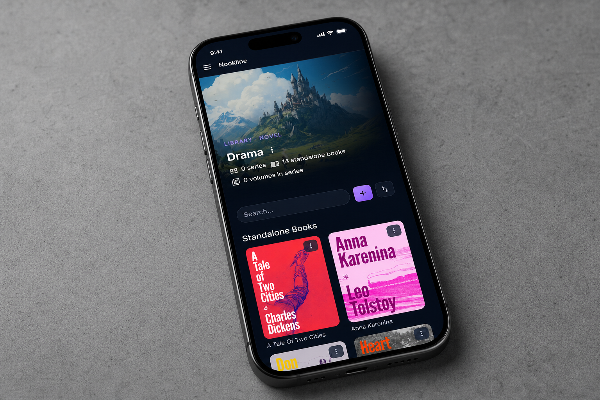
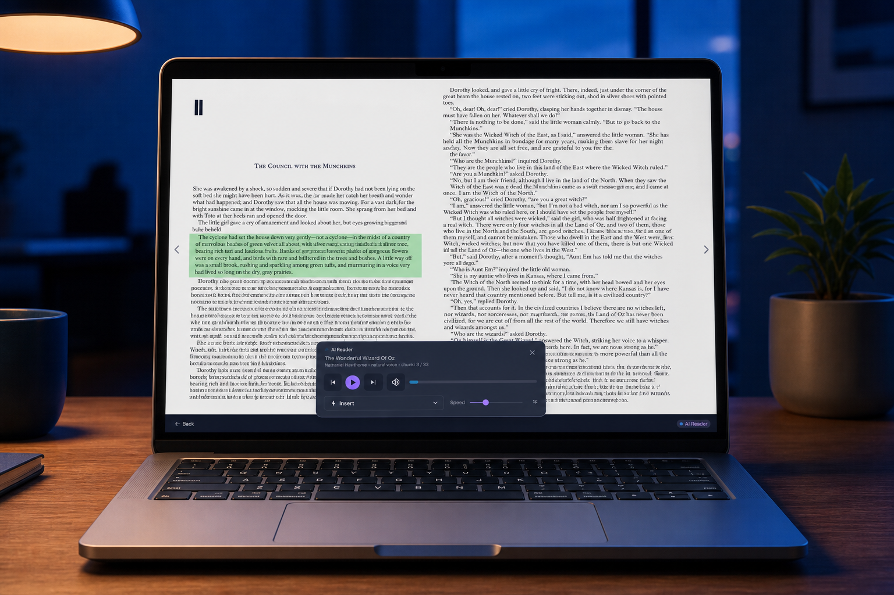
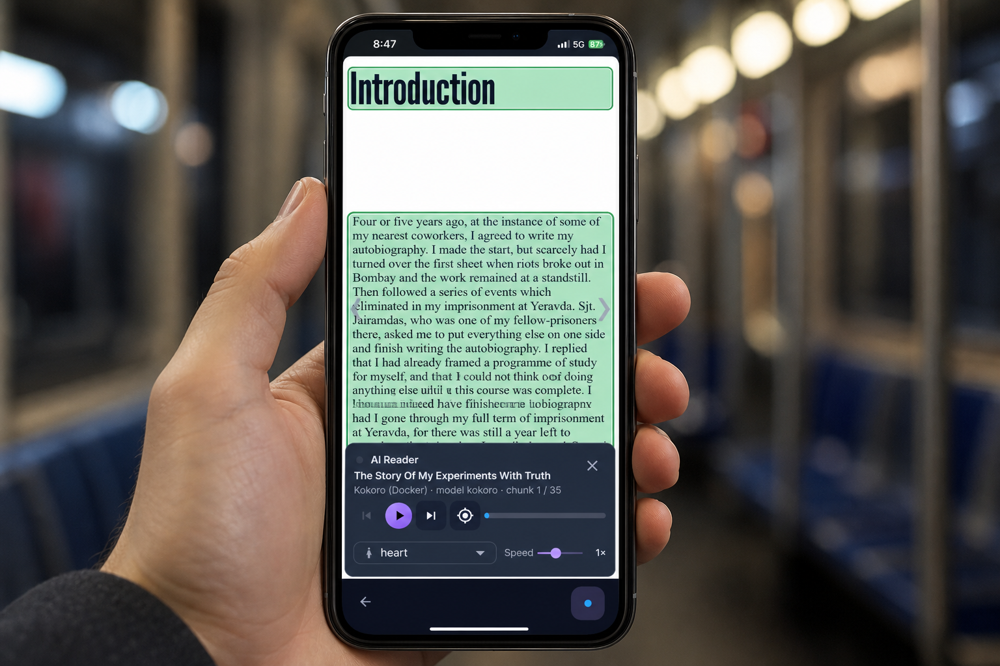

# Nookline

Personal library and reader stack (web UI + API). **Self‑host with Docker.**


---




<table>
<tbody>
<tr valign="top">
<td width="50%"></td>
<td width="50%"></td>
</tr>
<tr valign="top">
<td width="50%"></td>
<td width="50%"></td>
</tr>
<tr valign="top">
<td colspan="2"></td>
</tr>
</tbody>
</table>

---

## Prerequisites

- [Docker](https://docs.docker.com/get-docker/) and Docker Compose v2
- `.env` file (copy from `.env.example`)

---

## Quick start (no GPU Kokoro)

Best if you already run TTS elsewhere or you only care about reading without **AI reader / Kokoro**:

1. Copy env template and set a strong secret:

   ```bash
   cp .env.example .env
   ```

   Edit `.env`: set **`JWT_SECRET`** to a long random string (at least 32 characters).

2. Optionally point **`KOKORO_TTS_URL`** at another TTS host (CPU Kokoro, OpenAI-compatible server, etc.). If you skip this and omit the Kokoro service, voice features may error until `KOKORO_TTS_URL` is reachable.

3. Start only app services (default profile — **does not start** Kokoro):

   ```bash
   mkdir -p books
   docker compose up -d --build
   ```

   - Frontend: **http://localhost:${FRONTEND_PORT:-3009}**
   - API health: **http://localhost:${BACKEND_PORT:-4005}/api/health**

4. Uploaded files and SQLite live in the **`books`** bind mount (`BOOKS_BIND`) and **`nookline-data`** Docker volume respectively.

---

## With Kokoro (GPU, bundled profile)

Uses the optional **`kokoro`** Compose profile (`ghcr.io/remsky/kokoro-fastapi-gpu`). Requires **NVIDIA Container Toolkit** and a suitable GPU.

```bash
docker compose --profile kokoro up -d --build
```

`KOKORO_TTS_URL` in `.env` defaults to `http://kokoro-nookline:8880`, which resolves when the Kokoro container is running on profile `kokoro`.

Kokoro is also exposed on the host at **http://localhost:8882 → 8880** (see `docker-compose.yml`).

---

## Environment summary

| Variable | Purpose |
|----------|---------|
| **`JWT_SECRET`** | Required — signs session tokens in production Docker |
| **`BOOKS_BIND`** | Host folder mounted at `/books` in the backend |
| **`BACKEND_PORT`**, **`FRONTEND_PORT`** | Published HTTP ports |
| **`KOKORO_TTS_URL`** | Base URL for TTS used by AI reader flows |

Older deployments may set **`AUTH_SECRET`** instead of **`JWT_SECRET`**; both are recognized by the server (see backend auth).

---

## Development (without Compose)

See `frontend/` and `backend/` package scripts (`npm`, `bun`). Use a `.env` in each folder as documented in your local setup — **do not commit real secrets.**

---

## Security note for production installs

When **`NODE_ENV=production`** (set in Compose for the backend), the API **exits at startup** if the signing secret is missing, too short, or matches known weak placeholders. Always set **`JWT_SECRET`** (or **`AUTH_SECRET`**) properly before exposing the stack to the internet.

## License

This project is licensed under the **PolyForm Noncommercial License 1.0.0** — see [`LICENSE`](./LICENSE).

You may use, modify, and share it for **non‑commercial** purposes. **Commercial use** (selling/hosting-as-a-Service for profit, internal use tied to revenue, etc.) is **not** granted by that license; contact the maintainers if you need a commercial agreement.